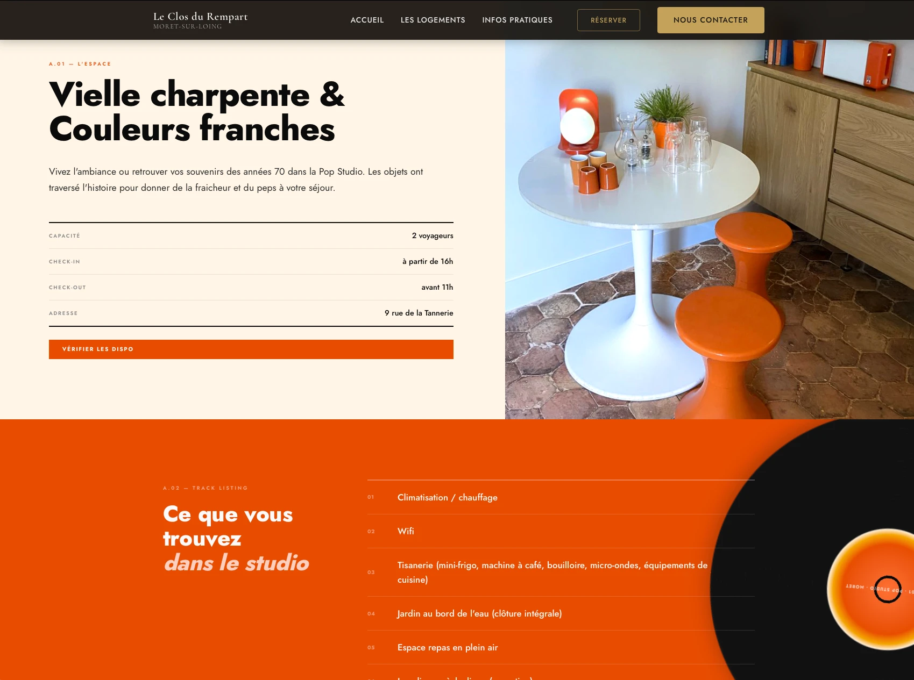

<!--
Accord de publication acquis (confirmé par Nicolas).
URL : https://leclosdurempart.com

Volontairement laissés de côté (détails opérationnels sensibles, pas
adaptés à une vitrine publique) : accès Stripe, authentification PIN du
personnel, nom du prestataire de ménage (pas son accord à lui), statut des
documents juridiques en brouillon, outils évalués puis écartés.
-->

## Le problème

Arnaud Magnin montait une maison d'hôtes haut de gamme à Moret-sur-Loing,
village médiéval classé associé au peintre Sisley, pendant que les travaux
étaient encore en cours. Il voulait un système de location courte durée
prêt à tourner en autonomie, sans avoir à y consacrer son temps.

Le périmètre a évolué en cours de route : d'abord envisagé à 7 unités, puis
3 appartements plus une offre groupée ("The Speakeasy"), le projet s'est
stabilisé à 5 logements indépendants (Book Nook, Spring Room, Captain's
Cabin, Pop Studio, Appartement du Sud).

## Ce qui a été fait

Un site vitrine WordPress sur mesure (thème basé sur Underscores), avec un
univers visuel propre à chaque logement (vert forêt et cuir pour Book
Nook, marine et orange pop 70s pour Pop Studio), dans un esprit éditorial
et immersif.

Au-delà du site : tout l'écosystème de distribution, avec Smoobu comme
channel manager central (source de vérité pour les prix et disponibilités),
synchronisé avec Airbnb et Booking.com, et les paiements via Stripe.

Et un outil sur mesure pour coordonner le personnel de ménage entre
plusieurs logements et plusieurs prestataires, connecté à Smoobu : un bon
exemple du type d'outil métier que Nicolas peut construire au-delà d'un
simple site vitrine (cf. §4 du brief).

## Le résultat

Sur la période observée (juillet 2026 – janvier 2027) : 199 réservations
pour 290 nuits, avec un taux d'occupation de 26,94 %. Booking.com et Airbnb
restent majoritaires, mais le site capte directement 13,92 % du chiffre
d'affaires (12,12 % des réservations) via son propre moteur de
réservation, une part qui échappe aux commissions des plateformes.

<!--
TODO pour Nicolas : le chiffre d'affaires exact (36 316,09 € sur la
période) n'est volontairement pas repris ici, c'est une donnée plus
sensible qu'une publication de projet classique. Dis-moi si tu veux
l'inclure quand même, l'arrondir, ou le garder privé.
-->
